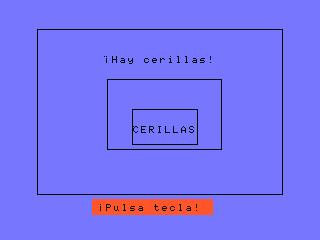
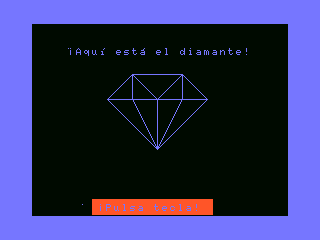
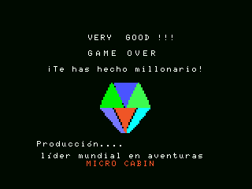

# Mystery House en castellano (MSX1)

Traducción al castellano de **Mystery House** (ミステリーハウス, Micro Cabin / Arrow Soft, 1983) para MSX1, en cinta. Es una aventura gráfica de texto: entras en una mansión abandonada, recorres sus salas vista a vista y escribes órdenes para encontrar el diamante escondido en la casa sin caer en sus trampas.

Se publica como **parche IPS** para la cinta (`.cas`). No se incluye ninguna cinta: necesitas tu propia copia del juego original.



## Qué tiene la traducción

* **Todo el texto en castellano**: presentación, instrucciones, ayuda, mensajes, muertes y final.
* **Tildes, ñ, ¿ y ¡ con dibujo propio.** El cargador copia la fuente de la BIOS a la RAM y añade sus propios dibujos, así que se ven igual en un MSX japonés que en uno europeo.
* **Órdenes en castellano** (cuentan las 3 primeras letras): subir, bajar, coger, abrir, usar, mover, buscar, leer, encender, tiempo, guardar, ayuda, fin... **Siguen valiendo las inglesas** del original y da igual escribir en mayúsculas o en minúsculas.
* **Arreglos.** En la cinta original el cuarto del fantasma termina el programa y el final cuelga el ordenador (cargan datos con `BLOAD ...,R` en direcciones de VRAM). En la traducción se ven los dos, incluido el diamante de sprites y el anuncio oculto de *Diamond Adventure*. La orden `tiempo` da la hora bien.

| | |
|---|---|
|  |  |

## Descargas

En [`releases/`](releases/):

| Fichero | Qué es |
|---|---|
| `MysteryHouse_ES_v1.0.ips` | Parche IPS. SHA-1 `93e6529899a41a14f45fe2eb34710f8796bb5cf0`. |

El parche **solo** vale para esta cinta:

| Cinta | Tamaño | SHA-1 |
|---|---|---|
| `Mystery House (1983)(Micro Cabin)(Japanese MSX)(JP)(en-jp)[SHIFT][CLOAD].cas` (TOSEC) | 31.862 bytes | `820b1d8d118cb36ad3369b33d29d74327b7cf018` |
| Resultado tras aplicar el parche | 33.502 bytes | `a1bd47bc6ab44eb0fb2bf14632ce33650d3ca365` |

Para aplicarlo sirve cualquier programa de parches IPS, como [Floating IPS](https://www.smwcentral.net/?p=section&a=details&id=11474) (`flips --apply MysteryHouse_ES_v1.0.ips original.cas MysteryHouse_ES.cas`) o Lunar IPS. Comprueba el SHA-1 de la cinta antes y después.

Se ha probado en openMSX con un Sony HB-11 (japonés) y un Sony HB-20P (europeo), y se ha jugado entera.

## Cómo se carga y se juega

`CLOAD`, `RUN`, F1 y, cuando salga `Ok`, otra vez `RUN` (igual que el original). En un MSX con disquetera, arranca con SHIFT pulsado para que quede memoria libre.

Los cursores giran y avanzan; las órdenes se escriben en dos pasos (verbo y objeto). La [solución completa](docs/SOLUCION.md) lo explica todo, con mapa. También está en [PDF](docs/MysteryHouse_solucion.pdf).

## Cómo se monta

Hace falta **Python 3**. El repositorio no incluye nada de la cinta: el programa original se lee de **tu propia copia**.

```sh
# 1. Copia tu cinta como orig.cas junto a build.py (comprueba el SHA-1 de arriba)
# 2. Monta la cinta traducida
python3 build.py                     # escribe MysteryHouse_ES.cas
# 3. Crea el parche: da el mismo que el de releases/
python3 tools/ips.py orig.cas MysteryHouse_ES.cas MysteryHouse_ES_v1.0.ips
# Listados de los dos programas BASIC de una cinta
python3 tools/lista.py MysteryHouse_ES.cas
```

## Qué hay en el repositorio

| Carpeta | Contenido |
|---|---|
| `trad/` | Las líneas BASIC traducidas o cambiadas del cargador (`es_MYS.txt`) y del juego (`es_MYS22.txt`). Cada línea sustituye a la del mismo número. |
| `tools/` | Detokenizador y tokenizador de MSX-BASIC con el juego de caracteres japonés, lectura y montaje de la cinta, listados y creación del parche. |
| `build.py` | Monta la cinta traducida a partir de tu `orig.cas`. |
| `docs/` | Solución, mapa, documentación técnica, curiosidades y lecciones. |
| `images/` | Capturas. |
| `releases/` | El parche IPS. |

## Documentación

* [Solución completa](docs/SOLUCION.md), con el [mapa](docs/mapa.png) y la versión en [PDF](docs/MysteryHouse_solucion.pdf).
* [Documentación técnica](docs/DOCUMENTACION.md): contenido de la cinta, estructura del programa, variables, salas y cómo está hecha la traducción.
* [Curiosidades](docs/CURIOSIDADES.md): el final que nunca se vio, el cuarto del fantasma, órdenes escondidas y otros fallos del original.
* [Lecciones](docs/LECCIONES.md): lo aprendido, útil para traducir otros juegos de MSX en BASIC.

## Créditos

* **Mystery House** (1983): Micro Cabin / Arrow Soft. Programa: Kazuhiko Okagawa (según el REM del cargador).
* **Traducción al castellano** (2026): dirección y pruebas, araubi.
* Ingeniería inversa, traducción, código y documentación: desarrollado con Claude (Anthropic).
* Herramientas: openMSX.

## Licencia y avisos

* **Código y herramientas propios** (`build.py`, `tools/`): licencia MIT, ver [LICENSE](LICENSE).
* **Traducción, documentación y dibujos propios** (`trad/`, `docs/`, este README y los dibujos de las letras con tilde, ñ, Ñ, ¿, ¡, el corazón y el cuadro): CC BY-NC-SA 4.0, ver [LICENSE-CC](LICENSE-CC).
* **El juego original no está cubierto por estas licencias.** Mystery House, su código, gráficos, música y textos son de Micro Cabin y de sus autores. Las líneas de `trad/` y el parche contienen código BASIC del original, que sigue siendo suyo. Las capturas de `images/` y de la documentación muestran el juego y tampoco están cubiertas.
* Es un homenaje sin ánimo de lucro. No se incluye ninguna cinta, ni la original ni la traducida, ni el listado completo del juego. Si algún titular de derechos lo pide, se retirará.
