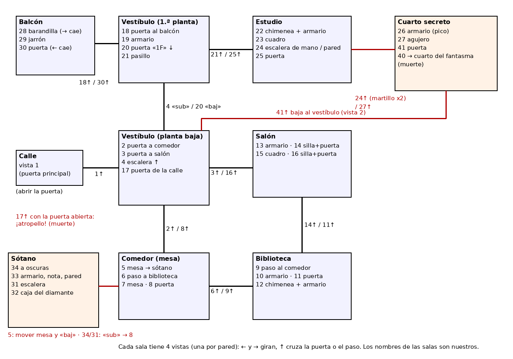

# Mystery House: solución

Solución comprobada jugando la partida entera en openMSX (Sony HB-11 japonés y HB-20P europeo) solo con pulsaciones de teclas, con la cinta original y con la traducción. También en PDF, con capturas: [MysteryHouse_solucion.pdf](MysteryHouse_solucion.pdf).

## Cómo se juega

* Cada sala tiene cuatro vistas, una por pared. **←** y **→** giran; **↑** cruza la puerta o el paso que tienes delante (si está abierto); **↓** solo sirve en dos sitios. **BS** vuelve a dibujar la vista y **ESPACIO** enseña el dibujo.
* Las órdenes se escriben en dos pasos: primero el verbo («¿Qué haces?») y, si hace falta, el objeto («¿Qué?»). Solo cuentan las **3 primeras letras**. Tras cada dibujo hay que pulsar una tecla.
* En la traducción valen las órdenes en castellano y también las originales en inglés (entre paréntesis en esta guía). En el juego original solo valen las inglesas, en minúsculas.
* Cuidado: **fin** (end) borra el programa de la memoria. Con **guardar** (save) se graba la partida en otra cinta, pero solo se guardan los objetos: puertas, pared rota, nota y agujero vuelven a como estaban.

## Mapa

## Dónde están los objetos

El juego los reparte con RND(1) sin semilla, así que **tras encender el ordenador el reparto es siempre el mismo** (el de esta guía). Si mueres y vuelves a empezar sin apagar, cambia.

| Objeto | Dónde puede estar | Tras encender |
|---|---|---|
| Vela (candle) | armario de las vistas 10, 13 o 19 | 19 (vestíbulo de la 1.ª planta) |
| Cerillas (match) | armario de la 12 o de la 22 | 22 (estudio) |
| Llave de los cuadros (key) | jarrón de la 12 o de la 29 | 29 (balcón) |
| Llave de las chimeneas (key) | silla de la 14 | 14 (salón) |
| Caja tras un cuadro (safe) | cuadro de la 15 o de la 23 | 23 (estudio) |
| Caja de chimenea (safe) | chimenea de la 12 o de la 22 | 12 (biblioteca) |
| Martillo (hammer) | dentro de una de esas dos cajas | caja del cuadro de la 23 |
| Pico (pick) | armario de la 26 (cuarto secreto) | 26 |
| Nota (memo) | armario del sótano (33) | 33 |
| Diamante | caja fuerte del sótano (32) | 32 |

## Paso a paso (reparto tras encender)

1. **Entrar en la casa.** Vista 1: **abrir puerta** (open door), ↑. Estás en el vestíbulo (vista 2). → para ver la escalera (4) y **subir** (up).
2. **Cerillas.** En la 1.ª planta (18): ←, ↑ por el pasillo hasta el estudio (22). **abrir armario** (open rack), **buscar armario** (search rack), **coger cerillas** (take match).
3. **Vela.** ← (24), ← (25), ↑ vuelves al vestíbulo de arriba (19). **abrir armario**, **buscar armario**, **coger vela** (take candle).
4. **Llave.** ← (18). **abrir puerta**, ↑ al balcón (28). ← (29): **buscar jarrón** (search vase), **coger llave** (take key). ¡Ojo! En la 28 → y en la 30 ← te caes.
5. **Martillo.** ← (30), **abrir puerta**, ↑ (20), → (21), ↑ (22), → (23). **mover cuadro** (move picture): aparece una caja fuerte. **usar llave** (use key), **abrir caja** (open safe), **coger martillo** (take hammer).
6. **Cuarto secreto.** ← (22), ← (24). **mover escalera** (move ladder), **usar martillo** dos veces (use hammer): «¡Hay un cuarto tras la pared!». ↑ entra en el cuarto secreto (26).
7. **Pico.** **abrir armario**, **buscar armario**, **coger pico** (take pick). ¡No vayas a la derecha: es el cuarto del fantasma!
8. **Sótano.** ← (41), ↑: la puerta te deja en el vestíbulo de abajo (2). **abrir puerta**, ↑ al comedor (5). **mover mesa** (move table): «¡Hay una entrada al sótano!». **bajar** (down).
9. **A oscuras.** En el sótano a oscuras (34) la ÚNICA orden que no mata es **encender vela** (light candle). Hace falta llevar vela y cerillas.
10. **La nota.** Vista 33: **abrir armario**, **coger nota** (take memo), **leer nota** (look memo): «¿Tienes pico?».
11. **El agujero.** **mover armario** (move rack) deja ver la pared; **usar pico** (use pick) hace un agujero.
12. **El diamante.** ↑ por el agujero (32). **abrir caja** (open safe): «¡Aquí está el diamante!». **coger diamante** (take diamond). ¡Has ganado!

## Final

Tras el diamante salen «VERY GOOD!!! GAME OVER», «¡Te has hecho millonario!», los créditos de MICRO CABIN, un diamante de sprites que cambia de color y un anuncio de *Diamond Adventure*. En la cinta original esta segunda parte no se ve nunca: el BLOAD de los sprites salta a la BIOS y el ordenador se cuelga en los créditos. La traducción lo arregla.

## Muertes

* Balcón: → en la vista 28 o ← en la 30.
* Sótano a oscuras: cualquier orden menos encender la vela.
* Vestíbulo: abrir la puerta de la calle (vista 17) y salir: te atropella un coche.
* Cuarto secreto: → en la 26 o ← en la 27 lleva al cuarto del fantasma. En la cinta original el programa se para con «Ok» (fallo del BLOAD); en la traducción se ve el fantasma y vuelves al menú.
